 

 

 

## `// 01`  HIGHLIGHTS

> 🏆 **Winner, EuroTech Federation × Hong Kong Talent Engage Hackathon (Munich, 2026).** Our team built **CrossLens**: alternative credit scoring for foreign SMEs that Hong Kong banks can't see. The prize: a winners' tour through **Hong Kong, Shenzhen and Guangzhou**.

## `// 02`  LIVE FROM GITHUB

Refreshed every 6 hours by a GitHub Action in this repo: real commits, real languages, real pings.

## `// 03`  HACKATHONS

| Event | What we built | Outcome |
|---|---|---|
| **EuroTech × Hong Kong Talent Engage** | CrossLens, credit scoring for SMEs entering Hong Kong | 🏆 **Winner** (FinTech track and overall) |
| **KI-Hackathon Energie** | Plankton PV, AI solar-planning assistant for Germany | Working demo, built overnight |
| **telli × LiveKit Voice AI** | Quorum, a voice AI API for group conversations | Working prototype |
| **Hyperbloom UI/UX & Web Design** | SafePause, a pause before risky bank transfers | Team of 3, live site |
| **Graphs Gone Wild (Neo4j)** | AutopsyGraph, forensics for AI agents | Built in 5.5 hours |

## `// 04`  THINGS I'VE BUILT

<table>
<tr>
<td width="50%" valign="top">

### 🎲 [Магнат](https://github.com/KanekiH4iSE/Monopoly)

Online multiplayer Monopoly-style game with an original theme. Join from any device. Deployed on Render and played by friends.

`Node.js` `WebSockets` `Render`

</td>
<td width="50%" valign="top">

### 🎰 [AniCase](https://github.com/KanekiH4iSE/Anime)

CS-style case roulette that picks what anime to watch: every spin eliminates one title. List import from Shikimori, AniList and MAL, plus a rematch slot.

`JavaScript` `Vercel`

</td>
</tr>
<tr>
<td width="50%" valign="top">

### ⏸️ [SafePause](https://github.com/KanekiH4iSE/Ausl-nder-Team)

Friction as a feature: a fintech app that makes you stop before an impulsive or scam-driven transfer. My part: research and frontend, Figma design plus the adaptive coded version.

`Figma` `React` `Vercel`

</td>
<td width="50%" valign="top">

### 🔬 [AutopsyGraph](https://github.com/KanekiH4iSE/autopsygraph)

Records another AI agent's runs as a knowledge graph in Neo4j and explains *why* it failed. Built at the Graphs Gone Wild hackathon.

`Python` `FastAPI` `Neo4j` `MCP`

</td>
</tr>
<tr>
<td width="50%" valign="top">

### 🎙️ Quorum

Multi-speaker group voice AI API: an agent that follows a conversation with several people at once. Built at the telli × LiveKit hackathon.

`LiveKit` `Deepgram` `Cartesia` `Claude`

</td>
<td width="50%" valign="top">

### 🛰️ [Last Orbit](https://github.com/KanekiH4iSE/last-orbit)

Browser survival game, built as a personal product and pushed through heuristic evaluation and redesign.

`JavaScript` `UX`

</td>
</tr>
<tr>
<td width="50%" valign="top">

### 🏦 Taler

PHP/MySQL banking admin system: atomic transfers, statements, legacy CSV import. I found Jira tickets marked "Done" with no code behind them and implemented them.

`PHP` `PDO` `MySQL`

</td>
<td width="50%" valign="top">

### 🖼️ WikiArt Style Classifier

Custom CNN vs EfficientNetV2-S vs ConvNeXt-Tiny on art-style classification, explained with Grad-CAM and SHAP.

`Python` `PyTorch` `Kaggle`

</td>
</tr>
</table>

## `// 05`  STACK

## `// 06`  CURRENTLY

- 🔎 Looking for a **Werkstudent or internship** (Backend / Python / Java / AI), Berlin or remote
- 🧪 Exploring how to debug AI agents: [AutopsyGraph](https://github.com/KanekiH4iSE/autopsygraph)
- 🎲 Keeping [Магнат](https://github.com/KanekiH4iSE/Monopoly) alive and fun

## `// 07`  WHAT I CARE ABOUT

- **Security, first-hand.** I've taken apart the MOVEit breach, compared TLS 1.3, Signal and AWS SigV4, and broken OWASP Juice Shop on purpose.
- **AI as a power tool, not a crutch.** Agents help me move fast; I still read every diff.
- **A live URL beats a perfect slide.** Everything with a green dot above is running right now.
- **Design with taste.** Dark, calm, intentional. If it looks like a template, I redo it.

 

**Tajik · Russian** (native) &nbsp;·&nbsp; **English** C1 &nbsp;·&nbsp; **German** B2 &nbsp;·&nbsp; **Turkish** A1

From Khujand to Berlin, one shipped prototype at a time.

