 

 

 

## `// 01`  HIGHLIGHTS

> 🏆 **Winner, EuroTech Federation × Hong Kong Talent Engage Hackathon (Munich, 2026).** Our team built **CrossLens**: alternative credit scoring for foreign SMEs that Hong Kong banks can't see. The prize: a winners' tour through **Hong Kong, Shenzhen and Guangzhou**.

## `// 02`  LIVE FROM GITHUB

Refreshed every 6 hours by a GitHub Action in this repo: real commits, real languages, real pings.

## `// 03`  HACKATHONS

## `// 04`  THINGS I'VE BUILT

## `// 05`  STACK

## `// 06`  CURRENTLY

- 🔎 Looking for a **Werkstudent or internship** (Backend / Python / Java / AI), Berlin or remote
- 🧪 Exploring how to debug AI agents: [AutopsyGraph](https://github.com/KanekiH4iSE/autopsygraph)
- 🎲 Keeping [Магнат](https://github.com/KanekiH4iSE/Monopoly) alive and fun

## `// 07`  WHAT I CARE ABOUT

- **Security, first-hand.** I've taken apart the MOVEit breach, compared TLS 1.3, Signal and AWS SigV4, and broken OWASP Juice Shop on purpose.
- **AI as a power tool, not a crutch.** Agents help me move fast; I still read every diff.
- **A live URL beats a perfect slide.** Everything with a live dot above is running right now.
- **Design with taste.** Dark, calm, intentional. If it looks like a template, I redo it.

 

**Tajik · Russian** (native) &nbsp;·&nbsp; **English** C1 &nbsp;·&nbsp; **German** B2 &nbsp;·&nbsp; **Turkish** A1

From Khujand to Berlin, one shipped prototype at a time.

