


 

 

 

## `// 01`  HIGHLIGHTS


> 🏆 **Winner, EuroTech Federation × Hong Kong Talent Engage Hackathon (Munich, 2026).** Our team built **CrossLens**: alternative credit scoring for foreign SMEs that Hong Kong banks can't see. The prize: a winners' tour through **Hong Kong, Shenzhen and Guangzhou**.

## `// 02`  LIVE FROM GITHUB

Refreshed every 6 hours by a GitHub Action in this repo: real commits, real languages, real pings.




## `// 03`  HACKATHONS

## `// 04`  THINGS I'VE BUILT

<a href="https://github.com/KanekiH4iSE/autopsygraph"></a>
<a href="https://github.com/KanekiH4iSE/Monopoly"></a>
<a href="https://github.com/KanekiH4iSE/Ausl-nder-Team"></a>

<a href="https://anicase-1.vercel.app"></a>

## `// 05`  STACK


## `// 06`  NOW


 

